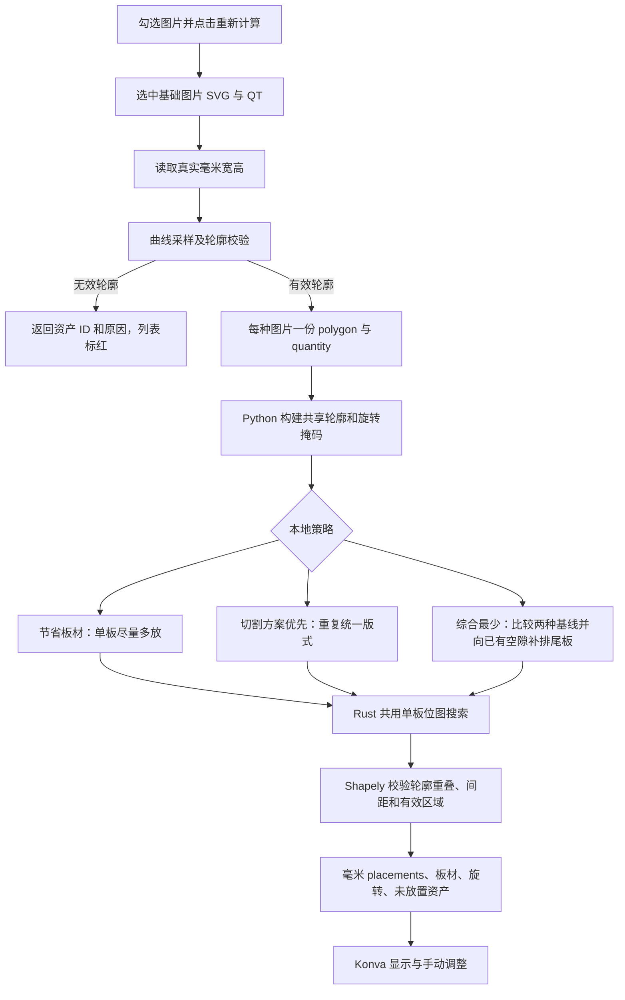

# 异形拼版当前流程与算法说明

更新：2026-10-15

当前只保留本地拼版，采用 Python 轮廓准备和策略调度、Rust 位图搜索、Shapely 最终几何校验。其余试验引擎的界面入口、适配器、原生依赖和专属测试已移除。历史调研记录用于解释过去的试验，不代表现有可选功能。

## 选图与临时 SVG 上传

顶部功能栏保持一行。版面配置默认收起，点击后横向展开，折叠动作不会修改配置或清空排版结果；窄窗口可横向滚动左侧工具区。上传区独立固定在右端，与下方待拼版侧栏共用宽度，展开配置时也不会换行。

进入“开始拼版”后的画布为空，不自动提取轮廓或计算。右侧任务复选框选择该任务全部图片，展开后可逐张勾选；每个任务显示已选图片数。可跨任务选择图片，只有选中且 QT 大于零的图片会送入计算。点击“重新计算”才开始排版；修改选择、修改已选图片的 QT 并保存、调整版面配置或切换策略，会清空旧结果，等待再次点击。“重新计算”始终根据全部已选图片和 QT 重新求解，不沿用手动版式。QT 保存失败时恢复已保存的数量。

工作区上传区域在 Tauri 桌面中接收单个 SVG，复用现有 SVG 导入与拆解能力：可识别的复合大图拆出素材，单图按真实毫米尺寸导入。导入进度显示读取、拆解和保存阶段，并在右侧生成“SVG 文件名 临时文件”任务。临时任务和 QT 修改保留在本次页面会话，不修改订单或示意图审核记录；上传完成后仍需勾选图片并主动计算。

右侧图片列表与导出弹窗的文件缩略图使用独立的小尺寸 PNG 接口，接近可视区域才加载；并发最多 2 个，缓存最多 64 张，离屏撤下图片元素。展开列表不会为全部素材读取原始 SVG。完整原图在排版结果需要显示时按基础图片读取，QT 副本共享资源。

## 计算流程

1. 每张基础图片的有效轮廓按路径和尺寸缓存，QT 不复制原始 SVG 或轮廓。送算 ID 使用 `任务ID::资产ID`，副本追加 `#qt-2` 等后缀；不同任务复用同一资产 ID 时仍保留各自 QT，不会覆盖。画布副本复用基础图片资源。
2. 后端继续剔除无效尺寸、自交或退化轮廓，并返回 `excludedItems: [{ id, reason }]`。该图片的异常不会阻止其他有效图片计算。
3. 本地策略通过 Python 子进程运行，stdout 仅输出毫米 JSON，stderr 的 `PRINTFLOW_PROGRESS` 行实时转发为 `imposition-progress`，画面展示正在准备、搜索还是校验。
4. 不使用固定 600 份 QT 限制，也不以 35 秒或 45 秒到达为由终止有效计算。Rust 核心按基础轮廓复用掩码，限制并行数和单次内存申请。
5. 算法仅处理轮廓和位图碰撞数据，不解码 SVG 的嵌入图像。原始图片由显示与导出流程读取。

## 三种策略共用搜索核心

源码统一位于 `src-tauri/src/imposition/local_nesting/`：`local_tools_engine.py` 根据策略调用 `nesting_common.py` 的 `pack_material_boards`、`nest_uniform.py` 的 `pack_uniform_boards` 或 `nest_combined.py` 的 `pack_combined_boards`，三者经 `nesting_rust.py` 调用 `.tools/nesting/native/printflow_nesting_core.dll`。Rust 核心源码位于同模块的 `rust_core/`。默认启用 Rust，保留 Python 参考实现用于差异对照与原生核心故障回退；实际使用核心写入结果和界面说明，回退不会冒充 Rust。

Rust 使用位图碰撞、候选位置缓存和受控角度并行搜索；默认 2 线程，最大 4 线程，低内存降为单线程。Python 仍负责轮廓处理、整体试排顺序、配额、版式评分与最终真实轮廓校验。

所有策略都以放入图片数量为基础。切割方案优先会复用包含相同位置和旋转的完整版式；切割方案优先和综合最少默认在画布折叠相同版式，只显示一块，并标注实际生产板材数量，可展开编辑。三种策略均不能突破有效区域和配置的图片间距，默认间距为 3 mm。

### 综合最少：在重复方案上更侧重节省板材

这是一层独立的多板优化策略，并不复制轮廓提取或 Rust 位图内核。先计算切割方案优先及节省板材两份完整结果，基础轮廓和所有旋转掩码只构建一次，两种试排共享。验证每款图片完整 QT、真实间距和板边界后，取综合成本较低的基线。

根据 2026-10-15 的需求，板材和切割布局按 **60:40** 的单位成本权重比较，内部采用等价整数评分 **`3 × 板材数量 + 2 × 不同切割布局数量`**，越低越好。这里的权重是每块板与每套切割方案的相对代价，不是对两个计数分别归一化；也不意味着结果一定减少 60% 板材。成本相同时先选板材更少，再选切割布局更少，最后用占用包围区域作连续余料的近似比较。例如 45 板／9 方案得 153，48 板／8 方案得 160，50 板／19 方案得 188；第一个候选最好。这是评分举例，不能视为已重现截图订单的实测结果。

基线之后，先将尾板上的实际需求补进其他已排板材。相同接收版式只搜索一次，可按剩余 QT 将同一新增布局复用到多个副本，避免反复搜索相同空隙。再将少量独立尾板与重复版式的部分副本合并，释放这些图片的位置，通过 Rust 重新排成更少的板材。候选同时考虑目标密度、可减少的旧切割方案和重复数量配额，避免只搜索极高密度的组合。其余板材保持原位置。

每个完整候选均重新校验全部有效 QT、Shapely 真实轮廓间距和板边界，并重新统计整份任务的切割布局。只有综合成本改善（或同成本下按上述顺序更优）才替换基线，所以不会为了补空隙而无限增加切割布局。一次候选失败不会丢弃已完成的合法方案。独立实现仍在 `nest_combined.py`，不改变节省板材和切割方案优先的默认算法。

额外余隙补排最多进行 32 次单板搜索、2 轮改善；版式重组另有 96 次单板搜索预算，每轮按不同条件选择最多 12 组邻域。预算限制新增试排工作量，不限制 QT，也不会因为墙钟超时中止整体拼版或丢弃合法结果。该策略需要实际比较两种基线，通常比单独选择一种策略更慢。它是有明确评分和回退保障的局部启发式，不保证全局最优，也不保证每批订单都比两种基线严格更好。

切割布局计数按轮廓点、真实宽高、绝对毫米位置及归一化角度判定，前后端使用相同的 0.01 精度；轮廓按基础图片缓存，相同轮廓的不同图片可共用切割程序。画布折叠和 PDF 则另外检查图片身份及更精细的位置，避免把不同印刷内容错误合并。

### 2026-10-15 综合策略初版验证

只读使用本机实际订单的 SVG 和原始 QT，未修改订单。对照轮廓由浏览器可见 SVG 几何采样，按订单毫米尺寸缩放；求解实际调用 Python/Rust，结果另外用 Shapely 检查完整图片边界、真实间距和每款数量。79 种／782 QT 样本是从 84 种订单排除五种各 50 QT 的底座所得，数量规模与截图一致，但未能确认是用户当时的同一组页面勾选，也不能将独立采样等同于生产 Rust 提取器的逐点结果。

| 真实输入 | 策略 | 板材 | 切割布局 | 综合成本 | 求解耗时 |
| --- | --- | ---: | ---: | ---: | ---: |
| 12 种／288 QT | 节省板材 | 16 | 9 | 66 | 6.77 秒 |
| 同上 | 切割方案优先 | 16 | 6 | 60 | 2.43 秒 |
| 同上 | 综合最少 | 16 | 6 | 60 | 20.34 秒 |
| 79 种／782 QT | 节省板材 | 50 | 20 | 190 | 26.47 秒 |
| 同上 | 切割方案优先 | 48 | 9 | 162 | 6.92 秒 |
| 同上 | 综合最少 | 48 | 9 | 162 | 37.28 秒 |

12 种样本的 288 QT 全部排入；79 种样本有两种各 1 QT 的自交轮廓被剔除，其余 780 QT 全部排入且身份唯一。综合结果独立检查 17,240 对同板轮廓，最小间距 3.51486 mm，无越界。两组综合试排均完成 32 次余隙搜索，没有找到成本更低的尾板改进，最终保留切割基线；尚未自动复现截图中的 45 块结果。这些耗时受当时系统内存和线程降级影响，不能当作稳定性能承诺。另在临时实验中分别尝试只保留最高单板面积候选、保留最高面积 95% 以上候选后再优先复用，两者仍为 48 板／9 方案，没有额外收益，因此未增加生产分支。

独立构造的合法两板样本则通过真实占用位图搜索合并为一板，证明尾板补排实际执行。新增回归还覆盖 1800 QT、相同轮廓的不同图片、任意角度、候选碰撞回退、阶段进度、双基线内存不足和 1 mm 重试。内存重试先释放旧搜索异常栈及缓存；存在合法基线时继续保留，最终仍须满足完整数量和间距。

界面验收使用实际 `ImpositionPage` 和 Konva、12 种真实 SVG／288 QT，三次选择分别调用真实 Python/Rust 求解，显示的板材和切割计数与独立统计一致。综合结果默认显示 6 种版式、共 16 块；展开到全板可视窗口后能逐一核对 288 个图片节点，折叠和展开不触发重算。导出在计算期间禁用，完成后恢复。页面回归 39 项、综合算法回归 13 项、原适配与内存回归 19 项通过；TypeScript 编译通过。

### 2026-10-15 按指定 ds 勾选范围修正综合搜索

界面名称改为 **综合最少（权重 60:40）**。本次从当前 SQLite 的只读快照核对数量，明确排除 `_1917861577712`、`_1917861576272`、`_1917861578432`、`_1917861578384`、`_1917861574064` 五张图片；剩余 79 张基础图片、782 QT。轮廓通过已编译的生产 Rust `extract_svg_polygon` 提取，再按当前订单尺寸进行与生产函数等价的线性缩放，不再使用浏览器采样轮廓作该订单的验收输入。

准确复现了切割方案优先的 **48 板 / 8 套切割布局 / 778 有效 QT**。图片编号 3、25、50 的轮廓无效，共 4 QT，继续单独剔除，不修改订单或其他图片数量。原综合策略与该基线相同，综合成本为 160。

定位到三个搜索缺口：重复物理板消耗同一空隙的搜索次数；已有图片全部固定，无法释放碎片空间；候选截断偏向需要达到 85–96% 密度的组合，漏掉约 74% 密度的重组方向。修正接收版式去重与批量复用，并加入多个独立尾板、部分重复版式副本和数量配额的重组搜索。真实改善来自释放三个独立尾板及部分重复模板，在第 15 次局部单板搜索得到 **47 板 / 9 套切割布局，成本 159**。

这份结果另外逐项检查所有有效 QT 和被剔除 QT 的完整标识集合，778 份有效图片没有丢失或重复。独立检查 17,542 对同板轮廓，最小间距为 **3.552568 mm**，轮廓与完整图片框均在有效区域内。

**尚未找到用户提出的 46 板 / 10 套布局（成本 158）。** 额外试验包括：76/78 大图的配额和首件角度、真实面积前沿、不同全局排列顺序、局部续搜、重组后补空隙，以及 0.25 mm 栅格的 32 次局部搜索，均未继续改善，因此未加入无收益的生产搜索，也没有放松间距或少排有效图片来凑目标。调用真实 Rust 核心的综合算法与跨方案重排回归共 26 项通过，页面标签的 24 项回归通过。

最终再从实际 `ImpositionPage` 页面选择综合策略，以同一批 79 图及生产轮廓启动完整 Python/Rust 入口，而非直接显示实验结果。两份基线分别为 50 板 / 19 套和 48 板 / 8 套；综合搜索最终为 47 板 / 9 套。完整求解耗时 65.5 秒，实际使用 Rust 两线程，共 311 次原生单板调用、0 次 Python 搜索回退，基础掩码占用约 7.9 MB。页面显示 9 种版式、共 47 块，加载时导出禁用，完成后恢复；前端统计与独立几何校验一致。该耗时是本机这次测试记录，不代表所有订单或设备。

实际订单、SQLite 快照、临时变体和检查报告均保留在系统临时目录，未放入发布资源。精确订单验证目录为 `printflow-ds-production-exact-20261015`，最终页面与完整入口的验证目录为 `printflow-combined-qa-IS8FRF`。

## 手动编辑与跨方案重算

切割方案优先和综合最少默认折叠，但代表板材支持直接移动和旋转。同板编辑按素材与原位置匹配每个重复板材中的对应图片，保留各自 QT 身份。展开全部板材后，同板编辑只修改当前实际板材，也可再次折叠。合法的移动和旋转直接提交到当前画布，导出使用这些位置。

跨方案拖动表示修改版式安排，松手后自动重算全部生产需求，并非只搬走一份 QT。请求传递原始模板、原生产份数、被拖动的具体槽位及目标毫米落点；原画布在加载期间保留，并暂停编辑和导出，数量校验通过后一次替换。重算失败保留原方案，恢复编辑和导出，不保存待重试的移动意图。再次跨方案拖动才发起新的特殊重算；点击“重新计算”仍然执行普通全量排版。源模板有多个相同图片时，只删除被拖动的那个槽位，不批量删除同款槽位。

跨方案特殊算法独立放在 `src-tauri/src/imposition/local_nesting/nest_replan.py`，前端提交校验位于 `src/modules/imposition/templatePlanRepack.ts`。它固定目标现有图片及拖入落点，将真实轮廓保守栅格化为初始占用位图，通过 Rust 单板核心继续搜索空隙。手工落点支持非栅格坐标及任意旋转，不强制改为 0.5 mm 或 15°。策略尝试数量配额和重复份数，优先将被拖动图片安排到目标；余量再进入来源和其他原有方案的空隙，仍有剩余时调用原策略生成新板。生产份数、板材数量和其他方案可能变化，所有有效图片的总 QT 必须保持原值。最终由 Shapely 检查实际轮廓间距和完整图片边界，再统一生成唯一 QT 身份。该过程是启发式搜索，不保证全局最优。

旋转在手势过程中校验有效区域和真实轮廓间距，遇到非法角度停在最近可行角度；松手提交该位置，不退回手势初始角度。选框同步合法角度。单次旋转细化搜索采用 8 ms 软预算，预算耗尽保留已校验角度；一项几何检查本身不能被同步打断。间距浮点容差为 0.0000001 mm，不允许用可见间距误差换取放置。

普通“重新计算”只提交全部已选有效基础图片及 QT，不携带 `templateRepack`；只有跨方案拖动的一次事务会提交该字段。页面不保留独立的手动方案模式，也不提供“重新自动排版”入口。跨方案重算不生成空白生产板，导出始终读取校验后已提交的位置。

拖动自动旋转暂不开放：2026-10-15 在 Edge 中以 4 个真实 SVG 轮廓（762–1098 个点）、1008 份 QT/42 块板材构造近邻压力场景，附近 11 个角度检查平均 51.24 ms、P95 54.9 ms；单角度最慢 17.1 ms。缓存邻居轮廓仍无明显改善，超过交互目标预算。这是控制布局基准，不是完整 84 图订单的排版耗时。普通鼠标拖动仅校验当前角度；Python/OpenCV 的离线掩码准备不在鼠标移动事件中执行。

交互实现：`packingEdits.ts`（数量守恒及折叠方案编辑）、`impositionGeometry.ts`（空间索引与碰撞）、`impositionRotation.ts`（旋转限位）、`ImpositionKonvaCanvas.tsx`（手势事务与显示）。

### 2026-10-15 跨方案重排验证

- 原有图片已因尺寸等原因被剔除时，继续保留其未排数量和右侧红色提示；这些图片不阻塞有效方案的跨板重算。计算失败保留原画布并恢复编辑和导出；普通“重新计算”重新提交全量需求，新的跨方案拖动才发起新的特殊事务。
- Edge 中使用实际页面、Konva 和 3 张项目 SVG（真实采样轮廓分别为 1139、1145、1100 点）执行鼠标拖动、旋转和跨方案释放。初始版式是固定测试输入，特殊重排调用真实 Python/Rust worker；未模拟算法输出，也不等同于完整生产订单验收。
- 5 QT 用例按 2/2/1 数量从 3 块板重排为 1 块，实际重排 883 ms；目标落点及 29.443° 角度保留，加载中禁用导出并保留旧画布。独立 Shapely 检查 10 对轮廓，最小间距 3.8537 mm，无越界。
- 同一批真实 SVG 的 10/10/5 共 25 QT 用例，实际重排 1279 ms、全部放入 1 块；300 对轮廓最小间距 3.7297 mm。两次均确认为 Rust 双线程，Python 搜索回退次数为零。小样本耗时不代表千份订单耗时。
- 独立算法测试覆盖目标仅能容纳两件、向其他已有方案补排、任意角度与非栅格落点、非零板边距及失败事务。1802 QT 的简单轮廓用例只构建一次共享掩码，全部副本无重复、无遗漏。
- Rust 核心与 Python 参考实现对初始占用位图做差分测试，覆盖 1/2/4 线程、跨 64 位字边界、输入内存/尺寸检查，以及旧 DLL 缺少新入口时保留占用区域再回退。安装资源清单及打包验证包含独立特殊模块。

## 安装与验证

见 [本地拼版运行说明](../scripts/nesting/README.md)。性能对照、输入约束和完整验收记录见 [Rust 搜索核心与性能验收](./本地拼版Rust搜索核心与性能验收-2026-10-13.md)。

运行必需源码为 `src-tauri/src/imposition/local_nesting/`，本机依赖为 `.tools/nesting/.venv` 和 `.tools/nesting/native`。这些路径仅用于开发。Windows 安装包在打包前准备 `src-tauri/resources/imposition-runtime/`，包含六个适配模块（含综合最少和跨方案特殊策略）、独立 Python 3.13、固定生产依赖和 Rust DLL；正式版通过 Tauri 安装资源目录加载，不要求目标电脑保留项目源码或安装 Python。子进程通过 UTF-8 通信。构建会从项目外、中文和空格目录验证三种策略使用 Rust 核心，详见本地拼版运行说明。根目录旧 `tools/` 的运行部分已迁入模块，独立 GUI、CLI 和旧导出代码已清理。测试、基准辅助和安装脚本位于 `scripts/nesting/`，不参与软件计算入口；测试报告、临时结果与编译缓存不是生产资产。

## 拼版 PDF 图层导出

拼版工作区的“导出 PDF”读取当前画布已经提交的位置和旋转，包括手动跨板移动后的结果。弹窗打开后先显示项目通用加载动画及 SVG 读取进度，再展示图层和板材预览。原始素材按基础图片解析；图层筛选不会重新裁边或移动图片，PDF 页面使用原板材毫米宽高，不套用 A4。

- 图层类型固定为“轮廓 / 路径”“图片”“彩窗”“白墨”和“不导出”，不再提供自定义导出分组、新建或合并组。默认识别路径、图片和颜色／渐变填充；填充元素归入彩窗，白墨由人工指定，不把普通白色填充直接当作白墨。
- **每种版式导出一份多页 PDF**，页序为轮廓、图片 1、图片 2（以及更多图片通道）、彩窗、白墨；没有对应内容的类型跳过，不添加空页。图片类型按全板序号合并：每个 SVG 当前被指定为“图片”的图层按文档顺序编号，整块板材上各 SVG 的第 1 个图片层合为同一页，第 2 个图片层合为另一页，依此类推；不同 SVG 的图层 ID 或名称不必相同。只有一个图片层的 SVG 只参加图片 1 页，同源 QT 副本保留在对应页面的原板材位置。更改图层类型后会按剩余的图片层重新编号。轮廓／路径、彩窗、白墨分别按整板同类型合为一页。
- 按版式选择 SVG，文件下拉带缩略图；逐层选择类型，勾选图层可查看单独预览。“全选”用于预览选择，其右侧不再提供批量归组下拉。未识别图层需明确指定类型或“不导出”后才能导出。
- 蓝色“应用到同名svg”按钮将当前 SVG 的类型分配应用到同名文件及其其他版式。匹配会同时校验图层结构，跳过同名但结构不一致的文件，避免错配图层；同一版式内同源 QT 副本始终同步。
- 每页 PDF 都保留空心圆路径版面孔，孔径、数量、左侧距和垂直居中位置与 Konva 画布一致。每页加 0.2 mm 黑色空心外边框，中心线内缩 0.1 mm，完整线宽处于页面范围内；页面尺寸、图片和孔位不变。原 SVG 的路径、图片、填充及引用资源继续保留；画布有效区域红框、利用率文字和选中框不导出。
- 相同素材、尺寸、位置和角度的板材只导出一份 PDF；不同图片即使轮廓相同也不合并，空板不导出。文件名使用导出当地年月日时分、版式序号和生产数量，例如 `202610140930_1B-9B_1F-5F.pdf`，不再加图层类型前缀。`1B-9B` 表示本次实际导出的 9 种版式中的第 1 种；只统计选中且产生文件的版式，按画布顺序连续编号，总数达到 10 时用 `01B` 补齐位数。`1F-5F` 表示这一版式需要生产 5 块板材、只导出其中一份；F 不随 PDF 页数递增。
- 文件按版式逐个生成并报告当前页面类型及进度。SVG 逐页生成、分块传输和解析，不把所有版式的 SVG 同时放进内存。一个版式的全部页面成功后才原子提交该 PDF；其中一页失败时不留下该版式的半份文件，并清理尝试过的所有临时页面。同名文件不覆盖；如果后续版式失败，弹窗保留已完成文件的路径，方便核对。

实现入口：`ImpositionPdfExportModal.tsx`（管理）、`impositionSvgExport.ts`（图层与毫米 SVG）、`impositionPdfExportService.ts`（分块传输）、`src-tauri/src/imposition_pdf.rs`（原尺寸 PDF）。
