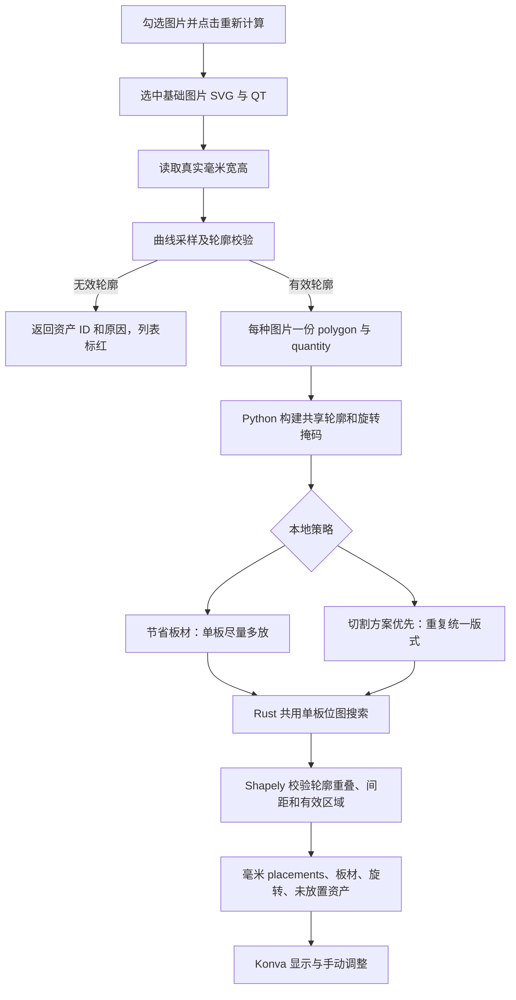

# 异形拼版当前流程与算法说明

更新：2026-10-13

当前只保留本地拼版，采用 Python 轮廓准备和策略调度、Rust 位图搜索、Shapely 最终几何校验。其余试验引擎的界面入口、适配器、原生依赖和专属测试已移除。历史调研记录用于解释过去的试验，不代表现有可选功能。

## 选图与临时 SVG 上传

顶部功能栏保持一行。版面配置默认收起，点击后横向展开，折叠动作不会修改配置或清空排版结果；窄窗口可横向滚动左侧工具区。上传区独立固定在右端，与下方待拼版侧栏共用宽度，展开配置时也不会换行。

进入“开始拼版”后的画布为空，不自动提取轮廓或计算。右侧任务复选框选择该任务全部图片，展开后可逐张勾选；每个任务显示已选图片数。可跨任务选择图片，只有选中且 QT 大于零的图片会送入计算。点击“重新计算”才开始排版；修改选择、修改已选图片的 QT 并保存，或调整版面与策略设置，会清空旧结果，等待再次点击。QT 保存失败时恢复已保存的数量。

工作区上传区域在 Tauri 桌面中接收单个 SVG，复用现有 SVG 导入与拆解能力：可识别的复合大图拆出素材，单图按真实毫米尺寸导入。导入进度显示读取、拆解和保存阶段，并在右侧生成“SVG 文件名 临时文件”任务。临时任务和 QT 修改保留在本次页面会话，不修改订单或示意图审核记录；上传完成后仍需勾选图片并主动计算。

右侧图片列表与导出弹窗的文件缩略图使用独立的小尺寸 PNG 接口，接近可视区域才加载；并发最多 2 个，缓存最多 64 张，离屏撤下图片元素。展开列表不会为全部素材读取原始 SVG。完整原图在排版结果需要显示时按基础图片读取，QT 副本共享资源。

## 计算流程

1. 每张基础图片的有效轮廓按路径和尺寸缓存，QT 不复制原始 SVG 或轮廓。送算 ID 使用 `任务ID::资产ID`，副本追加 `#qt-2` 等后缀；不同任务复用同一资产 ID 时仍保留各自 QT，不会覆盖。画布副本复用基础图片资源。
2. 后端继续剔除无效尺寸、自交或退化轮廓，并返回 `excludedItems: [{ id, reason }]`。该图片的异常不会阻止其他有效图片计算。
3. 本地策略通过 Python 子进程运行，stdout 仅输出毫米 JSON，stderr 的 `PRINTFLOW_PROGRESS` 行实时转发为 `imposition-progress`，画面展示正在准备、搜索还是校验。
4. 不使用固定 600 份 QT 限制，也不以 35 秒或 45 秒到达为由终止有效计算。Rust 核心按基础轮廓复用掩码，限制并行数和单次内存申请。
5. 算法仅处理轮廓和位图碰撞数据，不解码 SVG 的嵌入图像。原始图片由显示与导出流程读取。

## 两种策略共用搜索核心

源码统一位于 `src-tauri/src/imposition/local_nesting/`：`local_tools_engine.py` 根据策略调用 `nesting_common.py` 的 `pack_material_boards` 或 `nest_uniform.py` 的 `pack_uniform_boards`，两者经 `nesting_rust.py` 调用 `.tools/nesting/native/printflow_nesting_core.dll`。Rust 核心源码位于同模块的 `rust_core/`。默认启用 Rust，保留 Python 参考实现用于差异对照与原生核心故障回退；实际使用核心写入结果和界面说明，回退不会冒充 Rust。

Rust 使用位图碰撞、候选位置缓存和受控角度并行搜索；默认 2 线程，最大 4 线程，低内存降为单线程。Python 仍负责轮廓处理、整体试排顺序、配额、版式评分与最终真实轮廓校验。

所有策略都以放入图片数量为基础。切割方案优先会复用包含相同位置和旋转的完整版式；相同版式在画布只显示一块，并标注实际生产板材数量。两种策略均不能突破有效区域和配置的图片间距，默认间距为 3 mm。

## 安装与验证

见 [本地拼版运行说明](../scripts/nesting/README.md)。性能对照、输入约束和完整验收记录见 [Rust 搜索核心与性能验收](./本地拼版Rust搜索核心与性能验收-2026-10-13.md)。

运行必需源码为 `src-tauri/src/imposition/local_nesting/`，本机依赖为 `.tools/nesting/.venv` 和 `.tools/nesting/native`。根目录旧 `tools/` 的运行部分已迁入模块，独立 GUI、CLI 和旧导出代码已清理。测试、基准辅助和安装脚本位于 `scripts/nesting/`，不参与软件计算入口；测试报告、临时结果与编译缓存不是生产资产。

## 拼版 PDF 图层导出

拼版工作区的“导出 PDF”读取当前画布已经提交的位置和旋转，包括手动跨板移动后的结果。弹窗打开后先显示项目通用加载动画及 SVG 读取进度，再展示图层和板材预览。原始素材按基础图片解析；图层筛选不会重新裁边或移动图片，PDF 页面使用原板材毫米宽高，不套用 A4。

- 图层类型固定为“轮廓 / 路径”“图片”“彩窗”“白墨”和“不导出”，不再提供自定义导出分组、新建或合并组。默认识别路径、图片和颜色／渐变填充；填充元素归入彩窗，白墨由人工指定，不把普通白色填充直接当作白墨。
- **图片类型按全板序号合并**：每个 SVG 当前被指定为“图片”的图层按文档顺序编号，整块板材上各 SVG 的第 1 个图片层合为一份 PDF，第 2 个图片层另合为一份，依此类推；不同 SVG 的图层 ID 或名称不必相同。只有一个图片层的 SVG 只参加第 1 份，同源 QT 副本保留在对应 PDF 的原板材位置。更改图层类型后会按剩余的图片层重新编号。轮廓／路径、彩窗、白墨仍各按整板同类型合并输出。例如板上素材最多有两个图片层，则输出轮廓 1 份、图片 2 份，以及存在的其他类型各 1 份。
- 按版式选择 SVG，文件下拉带缩略图；逐层选择类型，勾选图层可查看单独预览。“全选”用于预览选择，其右侧不再提供批量归组下拉。未识别图层需明确指定类型或“不导出”后才能导出。
- 蓝色“应用到同名svg”按钮将当前 SVG 的类型分配应用到同名文件及其其他版式。匹配会同时校验图层结构，跳过同名但结构不一致的文件，避免错配图层；同一版式内同源 QT 副本始终同步。
- 每份 PDF 都保留版面孔，孔径、数量、左侧距和垂直居中位置与 Konva 画布一致。原 SVG 的路径、图片、填充及引用资源继续保留；画布有效区域红框、利用率文字和选中框不导出。
- 相同素材、尺寸、位置和角度的板材只导出一套；不同图片即使轮廓相同也不合并，空板不导出。文件名使用类型、导出当地年月日时分、版式序号和生产数量，例如 `轮廓_202610140930_1B-9B_1F-5F.pdf`。类型为“轮廓”“图片1”“图片2”“彩窗”“白墨”等，不再使用 SVG 文件名前缀。`1B-9B` 表示本次实际导出的 9 种版式中的第 1 种；只统计选中且产生文件的版式，按画布顺序连续编号，总数达到 10 时用 `01B` 补齐位数。`1F-5F` 表示这一版式需要生产 5 块板材、只导出其中一套；所有图片通道及其他类型均保持 `1F-5F`，F 不随 PDF 数量递增。
- 文件按版式逐个生成并报告进度：先导出版式 1 的轮廓、图片各通道、彩窗、白墨，再处理下一版式。文件名以类型开头，因此资源管理器按名称排序时会先按类型排列。同名文件不覆盖；如果后续文件失败，弹窗保留已完成文件的路径，方便核对。

实现入口：`ImpositionPdfExportModal.tsx`（管理）、`impositionSvgExport.ts`（图层与毫米 SVG）、`impositionPdfExportService.ts`（分块传输）、`src-tauri/src/imposition_pdf.rs`（原尺寸 PDF）。
